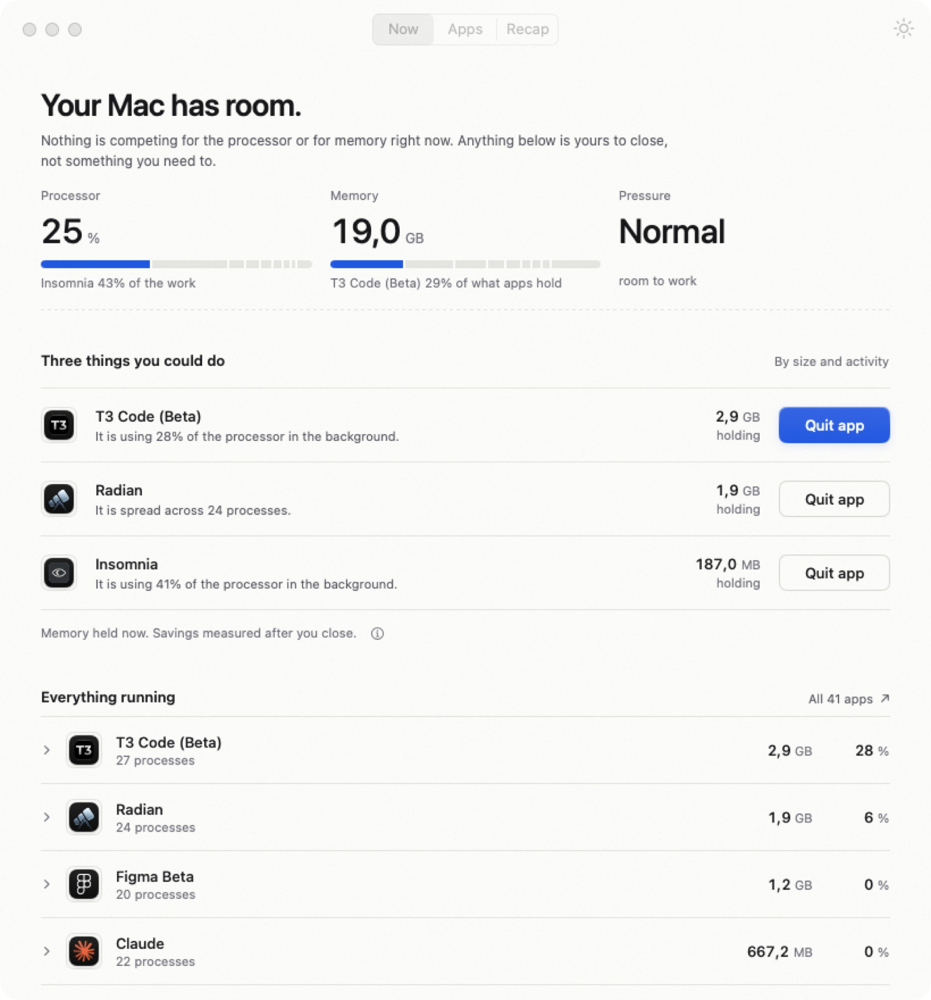
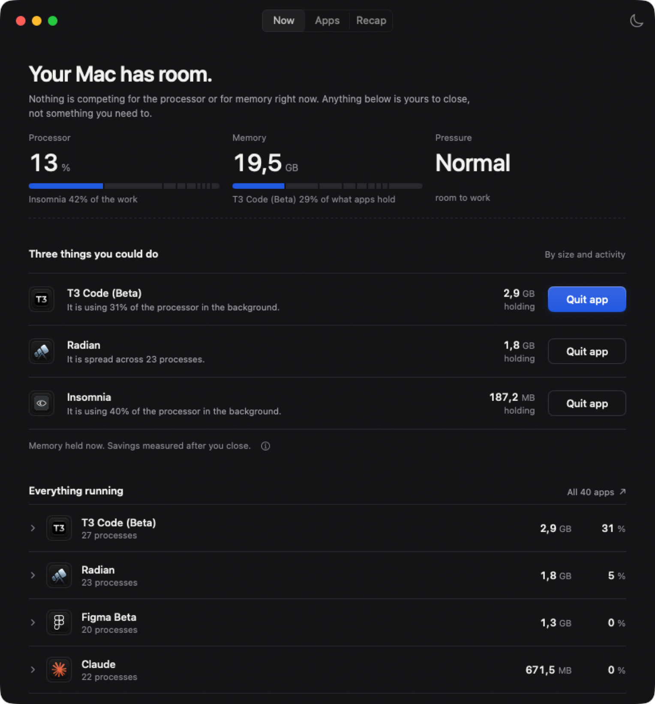

# Headroom

A native Mac app that tells you how your Mac is doing, what you could close to improve it, and what any of those cryptic processes actually are — then **measures** how much better it got after you act.



Four questions, nothing else:

- **Here is your performance.** One sentence, three readings, and a share bar under each one showing which app is eating it.
- **Here is how you can improve it.** Never more than three things, each naming a figure that was measured.
- **Here is what you can kill.** Apps, not processes. Cooperative quit by default.
- **What IS this thing.** Every row opens to say what it is, where it came from, and what its processes are doing.

Whatever you close, Headroom waits for the Mac to settle and reports what actually came back. Those numbers accumulate into a monthly recap.

## Why the numbers are measured, not predicted

An app's resident memory includes pages it shares with other apps, so "Slack is holding 1.6 GB" is not a promise that quitting Slack gives you 1.6 GB.

Headroom shows the footprint before you act, labelled as a footprint, and only claims a gain afterwards — from a before-and-after comparison, each side a median of three readings, with a noise floor beneath which it says *no measurable change* instead of inventing a win. Memory returned adds up across a month; processor use is a rate and is never summed, so the recap reports the best single action instead.

## Install

Requires **macOS 14 or newer** and a Swift 6 toolchain. The Xcode Command Line Tools are enough:

```sh
xcode-select --install     # if you do not already have them
git clone https://github.com/alexandroff-h/headroom.git
cd headroom
bash scripts/build-app.sh
open dist/Headroom.app
```

That produces a locally-signed `dist/Headroom.app`. It is not notarized, so it is for running from your own machine rather than for distribution.

Move it to `/Applications` if you want it to stick around:

```sh
cp -R dist/Headroom.app /Applications/
```

### No window permissions needed

Headroom reads only what the kernel will hand any process: `host_statistics`, `sysctl`, and `proc_pidinfo`. No accessibility permission, no screen recording, no admin rights, no helper tool.

## Use it from a terminal

The same readings, without opening a window:

```sh
dist/Headroom.app/Contents/MacOS/Headroom --sample
```

## What it keeps

One JSON file at `~/Library/Application Support/Headroom/actions.json`: what you closed, when, and what the measurement found. No account, no server, no telemetry. **Erase record** on the Recap screen deletes all of it.

## What it does to your Mac

Headroom asks apps to quit. The request is cooperative: the app can show a save dialog, or refuse. Force quit exists behind one explicit confirmation and is the only action here that can lose work. Headroom never kills a process on its own, never clears caches, never deletes files, and never offers to stop part of macOS.

## Dark mode



Light and dark are stepped separately against their own surfaces rather than flipped, and every contrast ratio in the design is measured rather than estimated. See [DESIGN.md](DESIGN.md).

## What it measures

- System processor activity, and the processor and resident memory of every process macOS will show it.
- macOS memory pressure, estimated used memory, and allocated swap.
- The system thermal state, and free space on the home volume — the latter only matters once it is too low for macOS to swap into.
- After an action: the difference in memory and processor use once the Mac has settled.

Readings identify likely causes; they do not prove the cause of every lag. Brief spikes are normal. High memory use, or swap allocated earlier, does not by itself mean the Mac is under pressure now. Processes macOS will not let Headroom inspect are missing or incomplete. Processor use is counted per core, so one app can exceed 100%. GPU, network and per-app UI stalls are out of scope.

## Development

```sh
swift test                      # 67 tests, core logic only
bash scripts/build-app.sh       # signed .app in dist/
bash scripts/check-compat.sh    # asserts it still deploys to macOS 14
```

`check-compat.sh` reads the Mach-O load command and the Info.plist, and lists every weak-linked SwiftUI entry point so a new one gets traced rather than assumed safe.

Headroom costs about **2% of one core** while sampling every two seconds. That is a product requirement, not an accident — a tool about wasted processor time may not waste it. `DESIGN.md` records the three fixes that got it there, including the one animation that cost 8% on its own.

## License

MIT. See [LICENSE](LICENSE).
